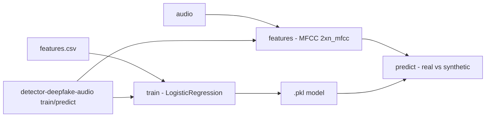

# detector-deepfake-audio

**English** · [Português (Brasil)](README.md)

[](#) [](#) [](#) [](#) [](LICENSE)

## What it is

**A baseline deepfake-audio detector**: it extracts **MFCC** features from an audio signal (via **librosa**), trains a **LogisticRegression** classifier (via scikit-learn) and predicts whether an audio clip is **real or synthetic**. Feature extraction produces a fixed-size vector (`2 × n_mfcc`: mean + standard deviation of the coefficients), independent of clip length. It is an educational ML-applied-to-audio lab.

## Status

An educational lab, working and tested (13 tests).

## Features

- **Feature extraction** (`features.py`): `extract_mfcc` and `extract_features_from_signal` — MFCC with `n_mfcc=13`, `n_fft=2048`, `hop_length=512`; a fixed-size `2 × n_mfcc` vector.
- **Model** (`model.py`): `DeepfakeAudioDetector` — a features + `LogisticRegression` pipeline (`random_state=42`); `TrainResult` with training accuracy.
- **CLI** (`cli.py`) with two subcommands:
  - `detector-deepfake-audio train --features <csv> [--model-out <pkl>]`
  - `detector-deepfake-audio predict <audio> --model <pkl>`

## Architecture

A `detector_deepfake_audio` package with `features` (librosa/MFCC), `model` (sklearn pipeline) and `cli` (train/predict). Training consumes a feature CSV; prediction extracts the MFCCs from the audio and applies the model.



## Stack

- Python ≥ 3.10
- librosa ≥ 0.10, scikit-learn ≥ 1.3, numpy ≥ 1.24
- pytest (dev)

## Repository layout

```
detector-deepfake-audio/
├── pyproject.toml · BRIEF.md
├── src/detector_deepfake_audio/
│   ├── features.py   # MFCC (librosa)
│   ├── model.py      # LogisticRegression pipeline
│   └── cli.py        # train / predict
├── tests/            # 13 tests
└── LICENSE           # MIT
```

## Prerequisites and installation

```bash
pip install -e .
```

## How to run

```bash
detector-deepfake-audio train --features features.csv --model-out model.pkl
detector-deepfake-audio predict sample.wav --model model.pkl
```

## Tests and quality

Real command (verified by the agent):

```bash
PYTHONPATH=src python -m pytest tests/
# 13 passed
```

## Technical decisions and trade-offs

- **MFCC + LogisticRegression as a baseline**: simple, fast and interpretable; neural models (RawNet, AASIST) beat this baseline but require far more data/compute.
- **Fixed-size vector (MFCC mean + std)**: independent of audio length, which simplifies training.

## Known limitations and roadmap

- An educational baseline — it does not compete with production deepfake detectors (ASVspoof).
- Training via a feature CSV; no bundled real/synthetic audio dataset.

## Development process

An individual project by Kelvin Oliveira, built with orchestrated AI agents and reviewed by the author.

## License and author

MIT — Copyright (c) 2026 Kelvin Rebelo de Oliveira. Author: [Kelvin Oliveira](https://github.com/KelvinOliveiraCode) · [Portfolio](https://kelvinoliveiracode.github.io/portfolio/)
