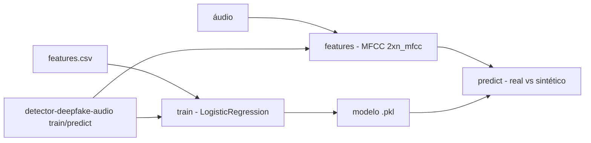

# detector-deepfake-audio

[English](README.en.md) · **Português (Brasil)**

[](#) [](#) [](#) [](#) [](LICENSE)

## O que é

**Detector de áudio deepfake (linha de base)**: extrai características **MFCC** de um sinal de áudio (via **librosa**), treina um classificador **LogisticRegression** (via scikit-learn) e prediz se um áudio é **real ou sintético**. A extração produz um vetor de tamanho fixo (`2 × n_mfcc`: média + desvio padrão dos coeficientes), independente da duração. É um laboratório educacional de ML aplicado a áudio.

## Status

Laboratório educacional funcional e testado (13 testes).

## Funcionalidades

- **Extração de características** (`features.py`): `extract_mfcc` e `extract_features_from_signal` — MFCC com `n_mfcc=13`, `n_fft=2048`, `hop_length=512`; vetor fixo de `2 × n_mfcc`.
- **Modelo** (`model.py`): `DeepfakeAudioDetector` — pipeline de características + `LogisticRegression` (`random_state=42`); `TrainResult` com acurácia de treino.
- **CLI** (`cli.py`) com dois subcomandos:
  - `detector-deepfake-audio train --features <csv> [--model-out <pkl>]`
  - `detector-deepfake-audio predict <audio> --model <pkl>`

## Arquitetura

Pacote `detector_deepfake_audio` com `features` (librosa/MFCC), `model` (pipeline sklearn) e `cli` (treino/predição). O treino consome um CSV de características; a predição extrai os MFCC do áudio e aplica o modelo.



## Stack

- Python ≥ 3.10
- librosa ≥ 0.10, scikit-learn ≥ 1.3, numpy ≥ 1.24
- pytest (dev)

## Estrutura do repositório

```
detector-deepfake-audio/
├── pyproject.toml · BRIEF.md
├── src/detector_deepfake_audio/
│   ├── features.py   # MFCC (librosa)
│   ├── model.py      # LogisticRegression pipeline
│   └── cli.py        # train / predict
├── tests/            # 13 testes
└── LICENSE           # MIT
```

## Pré-requisitos e instalação

```bash
pip install -e .
```

## Como executar

```bash
detector-deepfake-audio train --features features.csv --model-out modelo.pkl
detector-deepfake-audio predict amostra.wav --model modelo.pkl
```

## Testes e qualidade

Comando real (verificado pelo agente):

```bash
PYTHONPATH=src python -m pytest tests/
# 13 passed
```

## Decisões técnicas e trade-offs

- **MFCC + LogisticRegression como linha de base**: simples, rápido e interpretável; modelos neurais (RawNet, AASIST) superam essa baseline mas exigem muito mais dados/computação.
- **Vetor de tamanho fixo (média+desvio dos MFCC)**: independente da duração do áudio, o que simplifica o treino.

## Limitações conhecidas e roadmap

- Linha de base educacional — não compete com detectores de deepfake de produção (ASVspoof).
- Treino via CSV de características; sem dataset embutido de áudio real/sintético.

## Processo de desenvolvimento

Projeto individual de Kelvin Oliveira, construído com agentes de IA orquestrados e revisado pelo autor.

## Licença e autor

MIT — Copyright (c) 2026 Kelvin Rebelo de Oliveira. Autor: [Kelvin Oliveira](https://github.com/KelvinOliveiraCode) · [Portfólio](https://kelvinoliveiracode.github.io/portfolio/)
